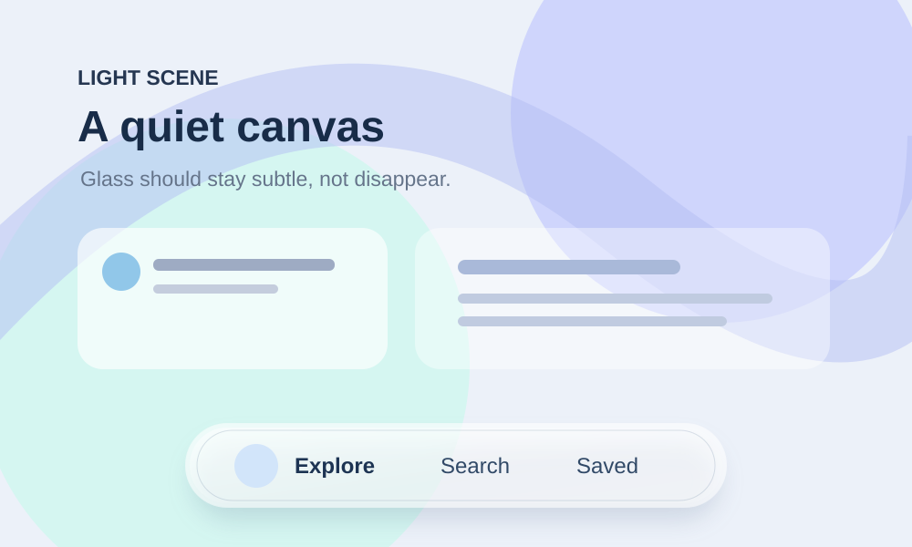
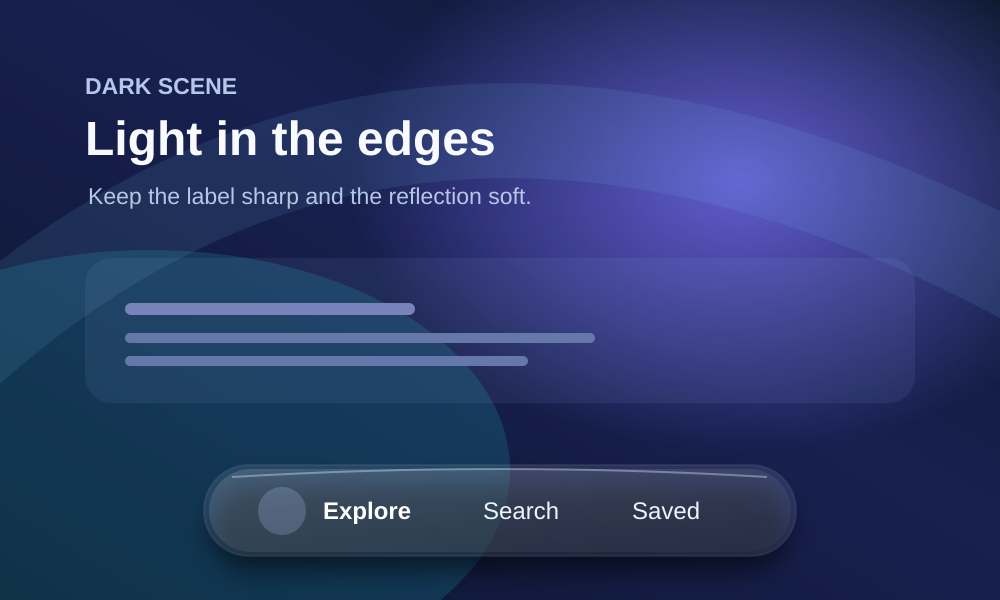
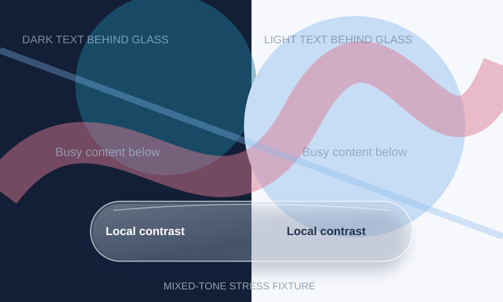

# Liquid Glass Visual Skill

**Reusable AI skill for high-fidelity glass UI design and implementation.** Works with any codebase, language, or framework, including C++. Built for Claude and other agents that read `SKILL.md`.

This is a **visual target + adaptive rendering + QA skill**, not a theme preset, CSS snippet, or copy of Apple's private renderer. It specifies how an interface must *look and behave*, then helps the agent choose suitable tools for the actual project.

## Use

1. Open [SKILL.md](liquid-glass-visual-skill/SKILL.md). Give Claude this URL or install the entire `liquid-glass-visual-skill/` folder as a skill.
2. Ask: **"Use the Liquid Glass Visual Skill in this repository to add adaptive glass UI to my project. Inspect my stack first. Follow its visual, performance, safety, and test gates. Show evidence, not just code."**
3. For a C++ project, the agent reads [C++ guide](liquid-glass-visual-skill/references/CPP.md) and may reuse the standalone [contrast helper](liquid-glass-visual-skill/tools/contrast.hpp), after reviewing compatibility.

## Structure

| File | Loaded when | Purpose |
| --- | --- | --- |
| [SKILL.md](liquid-glass-visual-skill/SKILL.md) | Skill activation | Short core contract and routing |
| [DESIGN.md](liquid-glass-visual-skill/references/DESIGN.md) | All glass UI tasks | Detailed visual and motion criteria |
| [TESTS.md](liquid-glass-visual-skill/references/TESTS.md) | Implementation / review | Evidence-based pass/fail checks |
| [CPP.md](liquid-glass-visual-skill/references/CPP.md) | C++ project only | API/tool selection and rendering strategy |
| [contrast.hpp](liquid-glass-visual-skill/tools/contrast.hpp) | Optional C++ contrast logic | Dependency-free reference math |
| [SECURITY.md](liquid-glass-visual-skill/references/SECURITY.md) | Working in any repo | Untrusted-input and change safety |
| [IMAGES.md](liquid-glass-visual-skill/references/IMAGES.md) | Visual reference work | Apple examples, licenses, original scenes |
| [SOURCES.md](liquid-glass-visual-skill/references/SOURCES.md) | Fact checking | Official Apple, W3C and framework docs |
| [contrast_test.cpp](liquid-glass-visual-skill/tests/contrast_test.cpp) | Optional C++ verification | Tiny unit test for the helper |

**Token-aware design:** short metadata and entrypoint; detailed references are read only when relevant. Plain English, no repeated boilerplate or hidden install scripts.

## Visual references

These are **original, reusable visual test scenes**, not Apple screenshots. For authentic visual and motion study, open [Apple's official Liquid Glass overview](https://developer.apple.com/documentation/technologyoverviews/liquid-glass), [Materials guidelines](https://developer.apple.com/design/human-interface-guidelines/materials), and [WWDC demo](https://developer.apple.com/videos/play/wwdc2025/219/). The [image study guide](liquid-glass-visual-skill/references/IMAGES.md) includes a CC0 community reference and explicit comparison steps.

## Non-negotiable outcome

The glass surface must adapt to the **visible backdrop**, preserve readable text/icons across mixed backgrounds and motion, show subtle optical depth, respond fluidly to interaction, and fall back cleanly when effects are unavailable. Blur + opacity alone is **not** sufficient. Never claim exact parity with Apple's proprietary implementation without proof.

## Trust and license

- No download/install/execute hooks, remote scripts, tokens, or credentials.
- Nothing is run by merely reading the skill.
- Included C++ helper is optional, local and dependency-free. Review before production use.
- MIT licensed; not affiliated with or endorsed by Apple. Apple trademarks remain theirs.

See [LICENSE](LICENSE).
