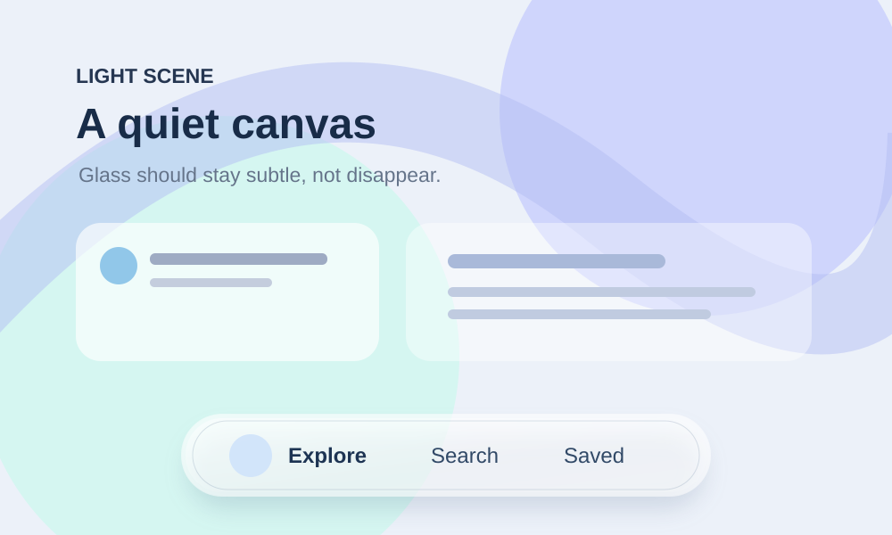
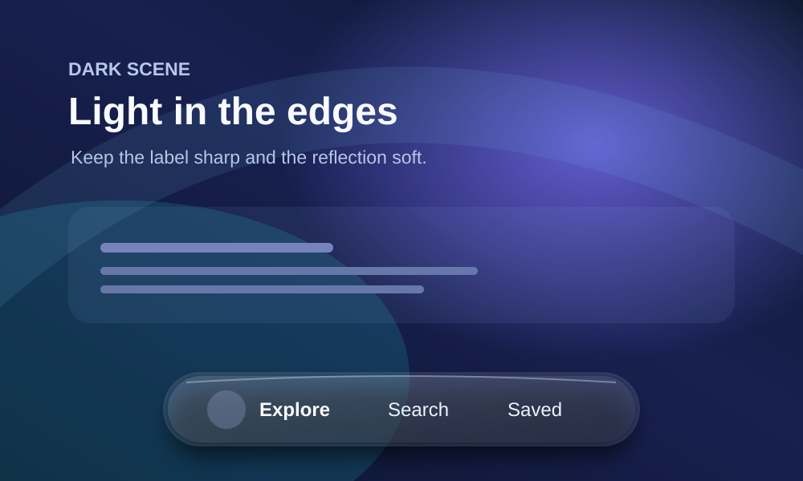
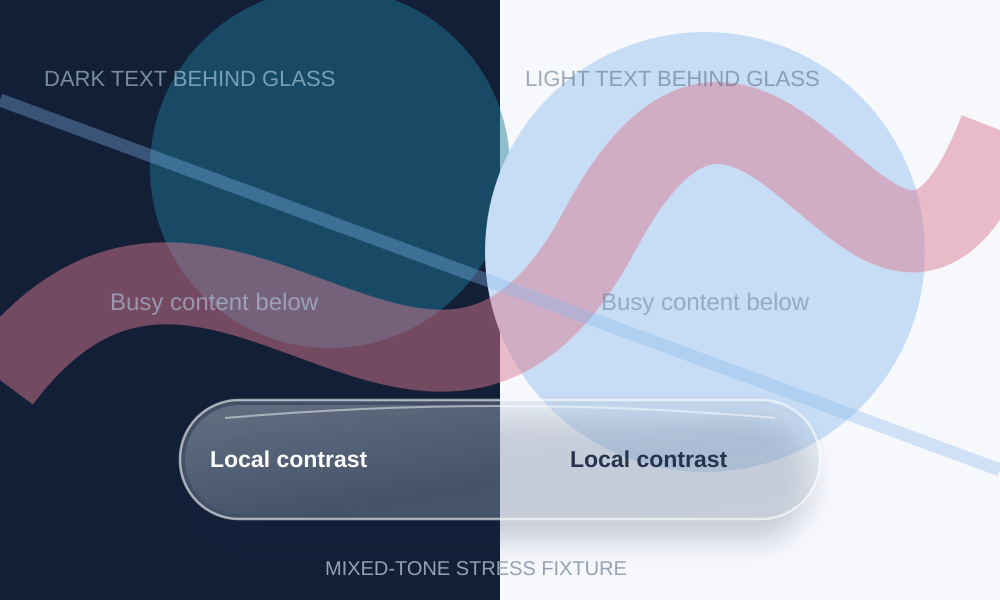

# Image reference workflow

Use original local fixtures as **test scenes**, not as Apple screenshots or targets to copy pixel for pixel.

## Local open-source images

### Light backdrop

Test whether a thin glass edge stays visible above very light content while labels remain dark and clear.

### Dark backdrop

Test restrained highlights, transmitted backdrop color and bright readable glyphs.

### Mixed backdrop

Test local backdrop analysis across sharp black/white transitions, vivid color and busy text. This drawing is a **stress input**, not a production glass renderer.

All local SVG artwork was created for this repository, contains no third-party UI screenshots or logos, and is covered by the repository's MIT license.

## Actual Apple screenshots and motion

Open these **official pages in a browser** when browsing is supported. Analyze their visual examples, clips and demo sequences:

1. [Apple Liquid Glass overview: images and before/after](https://developer.apple.com/documentation/technologyoverviews/liquid-glass)
2. [Apple HIG Materials: illustrated Regular vs Clear and placement](https://developer.apple.com/design/human-interface-guidelines/materials)
3. [WWDC Meet Liquid Glass: optics 01:29; adaptation 06:00; principles 10:31](https://developer.apple.com/videos/play/wwdc2025/219/)
4. [Apple custom views: shape, morph and interactive demo](https://developer.apple.com/documentation/swiftui/applying-liquid-glass-to-custom-views)
5. [WWDC new design system: hierarchy and continuity](https://developer.apple.com/videos/play/wwdc2025/356/)

**Do not bundle Apple images.** They are not automatically free to redistribute.

## Open-licensed community visual examples

**CC0 community comparison (externally hosted preview):**

[Source and license: Wikimedia Commons, by Gleepgs, CC0](https://commons.wikimedia.org/wiki/File:Liquid_Glass_app_icon_comparison_between_versions_26_and_26.png). This studies icon lighting, not the full system controls. The uploader's CC0 grant does not erase independent Apple trademark or design rights.
- [CC BY 4.0 3D app icon comparison](https://commons.wikimedia.org/wiki/File:Liquid_Glass_-_3D_effect_for_icons_2025-2026.png) — by LucaLindholm; attribution required. Kept as a link rather than copied.

## Required agent workflow

1. Review Apple's actual examples and **describe visible evidence**: transmission, diffusion, rim, edge lensing, depth, typography, contrast adaptation, morphing and response to content movement.
2. Load local light/dark/mixed fixtures as edge-case backgrounds. Their illustrations do **not** demonstrate real-time glass; the host app must render the effect.
3. Capture the *same real UI control* over each fixture with consistent scale. Compare the host output against observable Apple design principles, not exact screenshots.
4. Inspect enlarged edge/text crops; run moving-backdrop and scroll clips. Note flicker, lag, contrast failure and clipping.
5. Score using [TESTS.md](TESTS.md). If web access or live rendering is unavailable, say **NOT_TESTED**, never invent visual analysis.
